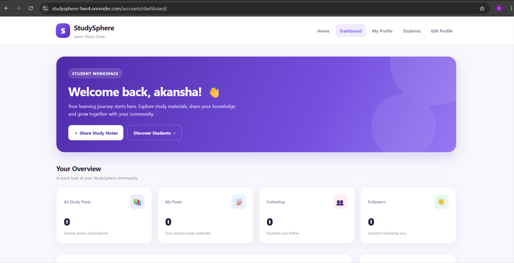

# StudySphere 🎓

### A Student-Centered Study Sharing Platform

StudySphere is a web application that helps students share study-related posts and connect through a learning community.

🌐 **Live Demo:** https://studysphere-9wv4.onrender.com

💻 **GitHub Repository:** https://github.com/ingle-shruti/StudySphere

## ✨ Features

- User signup and login
- Student dashboard
- Create and manage study posts
- Student profiles
- Likes and comments
- Notifications

## 🛠️ Technologies Used

- Python
- Django
- MongoDB
- HTML
- CSS
- JavaScript, where implemented
- Git and GitHub
- Render

## 🚀 Live Demo

Visit the deployed application:

https://studysphere-9wv4.onrender.com

Signup, login, and post creation have been tested successfully.

## ⚙️ Run Locally

### 1. Clone the repository

```bash
git clone https://github.com/ingle-shruti/StudySphere.git
```

### 2. Open the project folder

```bash
cd StudySphere
```

### 3. Install dependencies

```bash
python -m pip install -r requirements.txt
```

### 4. Configure environment variables

Create a `.env` file using the variables required by the project settings. Configure your Django secret key and MongoDB connection details locally.

**Never upload your `.env` file or database credentials to GitHub.**

### 5. Apply migrations

```bash
python manage.py migrate
```

### 6. Start the development server

```bash
python manage.py runserver
```

Open http://127.0.0.1:8000/ in your browser.

## 📸 Screenshots

### Student Dashboard


## 🎯 Project Objective

The goal of StudySphere is to provide students with a platform to share educational content and participate in a student learning community.

## 📚 Learning Outcomes

- Django web application development
- User authentication
- MongoDB integration
- Version control using Git and GitHub
- Web application deployment using Render

## 💼 Internship Project

Developed as part of the CodeAlpha Full Stack Development Internship.

## 🔮 Future Improvements

- Study groups
- Improved post search and filtering
- Bookmarks for study resources
- Further UI and accessibility improvements

---

**Made with 💙 for student learning — StudySphere**
